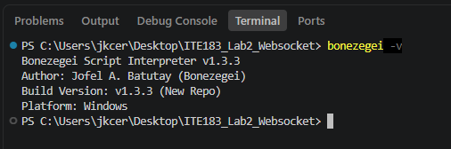
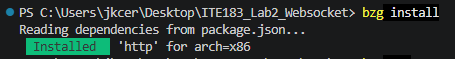
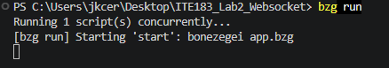
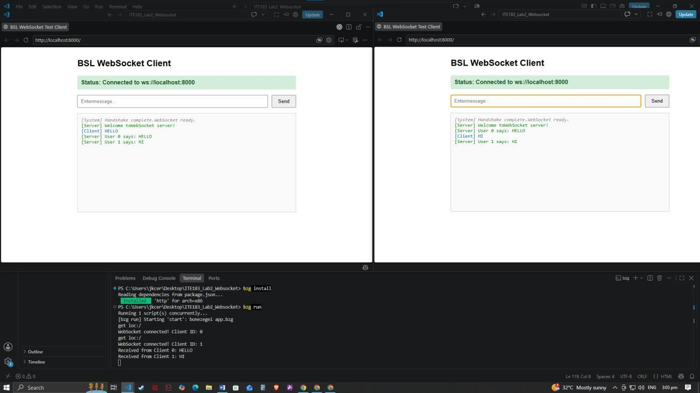
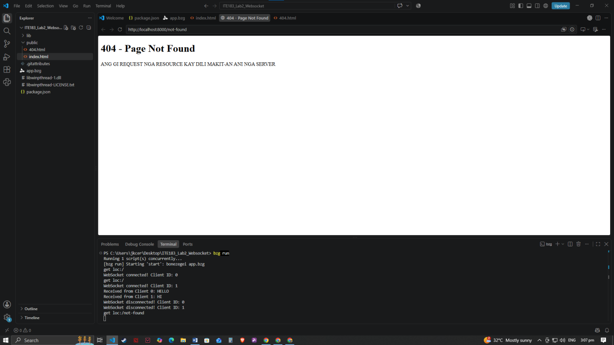

# ITE183 Laboratory 2: WebSocket Server

A real-time, multi-client chat application built with Bonezegei Scripting Language for ITE183 - Web Systems and Technologies.

## Features

- Serves the chat interface at `http://localhost:8000/`.
- Connects browser clients through `ws://localhost:8000`.
- Sends a welcome message to each newly connected client.
- Broadcasts messages to all connected clients with their client IDs.
- Logs connections, received messages, and disconnections.
- Displays a custom page for routes other than `/`.

## Requirements and setup

This copy includes Windows x64 native libraries. Install Bonezegei and make sure `bonezegei` and `bzg` are available in your terminal. The demonstrated interpreter version is **1.3.3**.

```powershell
git clone https://github.com/JKerbot/ITE183_Lab2_Websocket.git
cd ITE183_Lab2_Websocket
bonezegei -v
bzg install
bzg run
```

Open **http://localhost:8000/** in two browser tabs or windows. Keep the terminal running. Press **Ctrl+C** to stop the server. A quiet terminal after startup does not necessarily indicate a failure; open the URL to test it.

The checked-in `lib/` directory contains the HTTP dependency used for this Windows setup. `bzg install` installs or refreshes the dependency specified in `package.json`. Keep `libwinpthread-1.dll` in the project root when running from this directory.

## Project files

| File | Purpose |
| --- | --- |
| `app.bzg` | HTTP routing and WebSocket event handlers |
| `package.json` | Entry point, start command, and HTTP dependency |
| `public/index.html` | Browser chat interface |
| `public/404.html` | Custom missing-page view |
| `lib/` | HTTP library loader, metadata, and native DLL |
| `libwinpthread-1.dll` | Windows runtime dependency required by the HTTP DLL |
| `libwinpthread-LICENSE.txt` | Runtime dependency license |
| `screenshots/` | Original screenshot images extracted from the lab evidence PDF |
| `docs/bzg-websocket-lab.pdf` | Downloadable screenshot evidence |

## How it works

`app.bzg` loads the HTTP library and creates a server on port 8000. The GET handler serves the chat page for `/` and the custom missing-page view for other paths. The browser opens a persistent WebSocket connection to the same port.

`onConnect` welcomes the new client. `onData` receives a message and calls `server.sendAll()` to broadcast it to every active client, including its sender. `onDisconnect` records the departing client ID. The client enables its controls after connection and disables them when the connection closes.

The current implementation uses local HTTP and `ws://`, without TLS. Its browser WebSocket address is hardcoded to localhost. GitHub stores the project and documentation; GitHub Pages cannot run the Bonezegei backend.

## Testing and screenshot evidence

These screenshots were extracted from the supplied lab evidence PDF, rather than recreated. [Download the original evidence PDF](docs/bzg-websocket-lab.pdf).

### 1. Verify the interpreter

Run `bonezegei -v`. The captured output shows version 1.3.3 on Windows.



### 2. Install the dependency

Run `bzg install` from the project folder. The captured output shows the HTTP package installed successfully.



### 3. Start the server

Run `bzg run` and leave the terminal open.



### 4. Test two-client broadcasting

Open two windows at `http://localhost:8000/`. Wait for both to show Connected. Send `HELLO` from the first and `HI` from the second. Both clients should receive both broadcasts. The screenshot shows client IDs 0 and 1 and matching server logs.



### 5. Test the missing-page route and disconnects

Visit `http://localhost:8000/not-found`. The custom page should appear. Closing or navigating away from a chat client should trigger a disconnect log; reload the chat page to reconnect.



**HTTP status limitation:** the handler calls `sendFile("public/404.html")` without explicitly setting status 404. The screenshot verifies the page content only. Check the response in browser DevTools > Network before claiming that the server returns HTTP 404.

## Troubleshooting

### Failed to load library / Undefined variable http

In this Windows setup, `lib/http/http.dll` existed but depended on a missing `libwinpthread-1.dll`. Adding the compatible runtime DLL from the installed Git for Windows distribution to the project root resolved the load failure. Its license is included. The `Undefined variable http` and subsequent `server` error were consequences of that failed load.

### Nothing appears after bzg run

Open `http://localhost:8000/` in a browser. The command starts a server; it does not open a browser automatically. If the URL does not respond, check the terminal for errors and whether another application is using port 8000.

### Browser cannot connect

Start the server before opening the chat page, then reload. Run commands from the project root so relative library and HTML paths resolve correctly.

## References and license

Based on the course handout **Laboratory 2: WebSocket Server**, ITE183 - Web Systems and Technologies. The supplied `bzg-websocket-lab.pdf` provides the screenshot evidence above.

Project license: [MIT](LICENSE). Bundled third-party components retain their respective licenses; see [the libwinpthread license](libwinpthread-LICENSE.txt).
